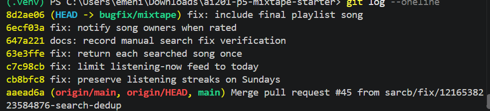

## AI usage

- **Issue #1:** I asked AI to explain the Sunday check and test failure. I checked the code and test myself before changing the code.
- **Issue #2:** I asked AI to explain the difference between the last 24 hours and today. I checked the time filter in the service and tested events from yesterday and today.
- **Issue #3:** I asked AI to explain how a database join can repeat results. I checked the search query and ran the test that showed the duplicates.
- **Issue #4:** I asked AI to compare rating and playlist notifications. I checked the service and added tests for rating someone else's song and rating your own song.
- **Issue #5:** I asked AI to explain the list slice in the playlist service. I checked the test results before removing it.

# Mixtape Codebase Map

## Application structure

- `app.py` creates and configures the Flask app, connects SQLAlchemy, registers the route groups, and creates database tables.
- `models.py` defines seven database models: `User`, `Tag`, `Song`, `ListeningEvent`, `Rating`, `Playlist`, and `Notification`. It also defines three link tables: friendships, song tags, and playlist entries. Playlist entries store each song's position and who added it. Each model has a `to_dict()` method for making JSON responses.
- `routes/` defines the API endpoints. `songs.py` handles song search, details, ratings, and listens. `playlists.py` handles playlists and their songs. `users.py` handles profiles, streaks, and notifications. `feed.py` handles listening-now and activity feeds. Routes read requests, call services, and return JSON.
- `services/` contains the app's feature logic. The services search for songs, manage playlists and streaks, create and retrieve notifications, and build feeds.
- `seed_data.py` clears and fills the database with example users, friendships, songs, tags, listens, playlists, and a notification.
- `tests/` checks streaks, song search, playlists, and notifications. The tests use a separate in-memory SQLite database.

## Data flow: rating a song

1. A client sends `POST /songs/<song_id>/rate` with a user's ID and a score.
2. The route in `routes/songs.py` reads those values and calls `rate_song()` in `services/notification_service.py`.
3. `rate_song()` checks the score, user, and song. It updates the user's existing rating or creates a new one.
4. The service saves the rating and returns it. The route turns it into JSON and sends the response.

## Organization patterns

- Flask blueprints group endpoints under `/songs`, `/playlists`, `/users`, and `/feed`.
- Routes handle requests and responses. Services handle feature logic and database work.
- Models define data and relationships. Link tables connect friends, songs and tags, and songs and playlists.
- Services return model objects or dictionaries. Routes return the results as JSON.

**Issue #1 — My listening streak keeps resetting**

- **How I reproduced it:** On Sunday, I set the test user's streak to 12 and last listen to Saturday. I sent a listen request to `POST /songs/<song_id>/listen`. The streak became 1 instead of 13. Before the fix, the Sunday test in `tests/test_streaks.py` also failed: it got 1 instead of 2.
- **How I found the root cause:** I followed the request from `routes/songs.py` to `record_listening_event()` and `update_listening_streak()` in `services/streak_service.py`. I ran the Sunday test before changing the code. The listen was saved, but the streak update failed.
- **The root cause:** The code only added to the streak if one day had passed and the new day was not Sunday. Python numbers Sunday as `6`, so a Saturday-to-Sunday listen skipped the add step and reset the streak.
- **My fix:** I removed the Sunday check. Now, listening one day after the last listen adds to the streak on any day. Listening again on the same day does not add to it, and missing a full day still resets it.
- **My side-effect check:** I ran `.\.venv\Scripts\python.exe -m pytest tests\test_streaks.py -q`. All five tests passed, including the Saturday-to-Sunday test with a streak of 12 becoming 13.

**Issue #2 — Friends Listening Now shows people from yesterday**

- **How I reproduced it:** Nova and Darius are friends in the seed data. I set Darius's latest listen to 20 hours ago and his older listens to two days ago. I opened `GET /feed/<nova_id>/listening-now`. Darius still appeared in the feed.
- **How I found the root cause:** I followed the endpoint in `routes/feed.py` to `get_friends_listening_now()` in `services/feed_service.py`. The service used a cutoff of the current time minus 24 hours.
- **The root cause:** A rolling 24-hour window includes some listens from yesterday. The report expects the feed to show listens from today only.
- **My fix:** I changed the time filter to include listens from midnight UTC today through the current time. The activity feed was not changed.
- **My side-effect check:** I tested with listens from yesterday and today. “Listening Now” showed only today's listen, and the activity feed still showed both. All five streak tests passed too.

**Issue #3 — The same song keeps showing up twice in search**

- **How I reproduced it:** I searched for the seeded song with `GET /songs/search?q=Anthem`. “Crown Heights Anthem” appeared three times.
- **How I found the root cause:** I followed the search route in `routes/songs.py` to `search_songs()` in `services/search_service.py`. The query joined songs to their tag rows. The multi-tag search test also returned the song three times.
- **The root cause:** Each tag row made another result row for the same song. “Crown Heights Anthem” has three tags, so it appeared three times.
- **My fix:** I removed the tag join, which the search did not need. The song's `to_dict()` method still includes its tags.
- **My side-effect check:** All five search tests passed, including searches for songs with no tags, one tag, and several tags. I also checked in the browser: “Crown Heights Anthem” appeared once and still showed its tags.

**Issue #4 — I got notified when a friend added my song to a playlist but not when they rated it**

- **How I reproduced it:** Darius rated a song shared by Nova with a score of 5. The rating was saved, but Nova's `GET /users/<nova_id>/notifications` response had no rating notification.
- **How I found the root cause:** I followed `POST /songs/<song_id>/rate` from `routes/songs.py` to `rate_song()` in `services/notification_service.py`. I compared it with `add_to_playlist()` in the same service, which creates a notification. `rate_song()` saved the rating and returned without creating one.
- **The root cause:** The rating code did not notify the person who shared the song.
- **My fix:** After saving the rating, `rate_song()` now uses `create_notification()` to notify the song's owner. It does not notify users when they rate their own songs.
- **My side-effect check:** Both new tests passed: rating someone else's song creates a notice, and rating your own song does not. The streak and search tests passed too (10 tests).

**Issue #5 — The last song in a playlist never shows up**

- **How I reproduced it:** The seeded “Friday Energy” playlist has seven songs. `GET /playlists/<playlist_id>/songs` returned six. Before the fix, tests also showed that a five-song playlist returned only four.
- **How I found the root cause:** I followed the endpoint in `routes/playlists.py` to `get_playlist_songs()` in `services/playlist_service.py`. The query sorted the songs correctly, but the function shortened the list before returning it.
- **The root cause:** The code used `songs[:-1]`, which means “all songs except the last one.”
- **My fix:** I removed that slice so the function returns every song in order.
- **My side-effect check:** All three playlist tests passed, including the empty playlist and song order checks. All 15 project tests passed. I also checked the API manually: “Friday Energy” returned `count: 7` and all seven songs in order.

## Commit log

- `8d2ae06` — `fix: include final playlist song`
- `6ecf03a` — `fix: notify song owners when rated`
- `647a221` — `docs: record manual search fix verification`
- `63e3ffe` — `fix: return each searched song once`
- `c7c98cb` — `fix: limit listening-now feed to today`
- `cb8bfc8` — `fix: preserve listening streaks on Sundays`